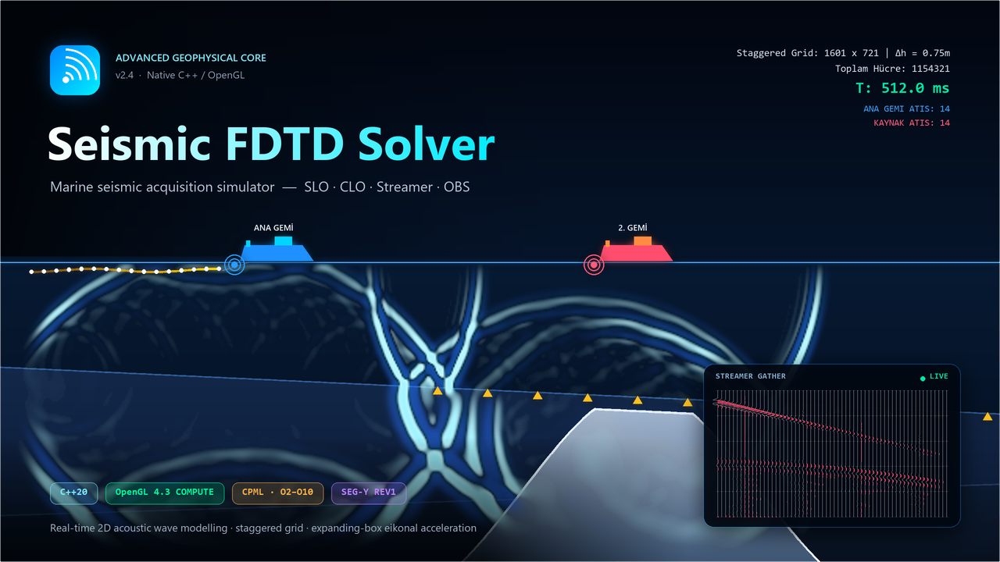
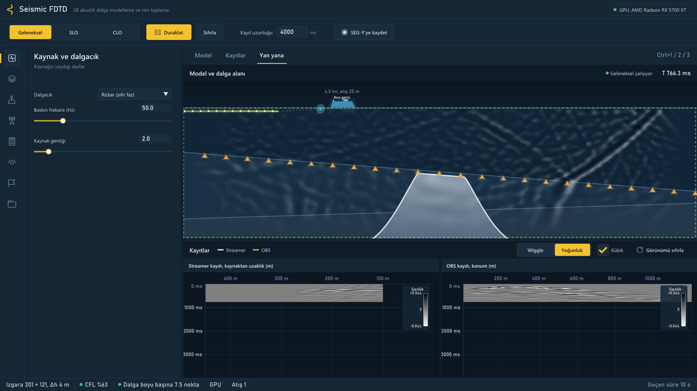
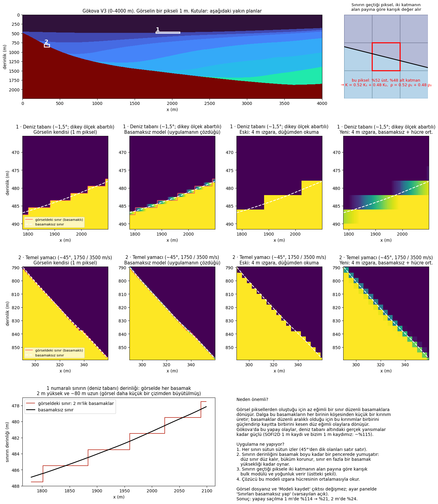

# 2D Wave Modelling — Seismic FDTD Solver



Gerçek zamanlı 2B akustik dalga modellemesi ile deniz sismiği veri toplama simülatörü. Kademeli ızgara (staggered grid) üzerinde değişken yoğunluklu sonlu farklar zaman alanı (FDTD) çözücüsü, OpenGL 4.3 compute shader'larıyla GPU'da ya da AVX2 vektörleştirilmiş çok iş parçacıklı CPU motorunda çalışır. Arayüz Dear ImGui ile yazılmıştır ve Türkçedir.

## Arayüz



Tek ekranlık bir çalışma istasyonu düzeni:

- **Komut çubuğu:** atış kipi (Geleneksel / SLO / CLO), başlat–duraklat (Boşluk tuşu), sıfırla, kayıt uzunluğu, canlı SEG-Y kaydı. Hat simülasyonu sürerken ilerleme ve durdurma düğmesi burada görünür.
- **Parametre grupları:** soldaki ikon şeridinden bir grup seçilir, panel yalnız o grubu gösterir (kaynak ve dalgacık, ortam ve yeraltı modeli, saha geometrisi, OBS, sayısal çözüm, görünüm, hat simülasyonu, parametre dosyası). Seçili ikona yeniden tıklamak paneli gizler.
- **Görünüm sekmeleri:** Model, Kayıtlar ve Yan yana (Ctrl+1 / 2 / 3). Yan yana görünümde üstte model ve dalga alanı, altta streamer ve OBS kayıtları; ayırıcılar sürüklenerek boyutlandırılır. Kayıtlarda wiggle ya da gri tonlu yoğunluk gösterimi, kübik ara değerleme, eksenlerde sürükleyerek kaydırma ve yakınlaştırma.
- **Durum çubuğu:** ızgara, CFL oranı, dalga boyu başına nokta, hesaplama motoru, atış sayısı. Başlık çubuğundaki GPU/CPU göstergesine tıklayınca motor değişir.

## Özellikler

**Fizik ve sayısal yöntem**
- Basınç–parçacık hızı (P, Vx, Vz) kademeli ızgara akustik FDTD, değişken yoğunluk (K = ρv², hız düğümlerinde 1/ρ), 2. – 10. derece uzaysal türevler
- CPML soğurucu sınırlar (Komatitsch & Martin, 2007) modelin dışında: çözücü ızgarası modelin her yanına soğurucu kalınlığında hücre ekler, model kenarları bu hücrelere uzatılır; modelin hiçbir kısmı soğurucu bölgede kalmaz. Sönümleme modelin en yüksek hızına göre ayarlanır
- Deniz yüzeyi yansıması (Dirichlet serbest yüzey) açılıp kapatılabilir; kapalıyken üstte de CPML
- Eikonal tabanlı genişleyen hesap kutusu: yalnızca dalganın ulaştığı bölge hesaplanır
- CFL kararlılık ve dalga boyu başına nokta göstergeleri; yüklenen model kararlılık sınırını aşarsa zaman adımı kendiliğinden düşürülür

**Yeraltı modeli**
- Hazır modeller: düz katmanlar, fay, tuz domu
- Dosyadan hız ve (isteğe bağlı) yoğunluk modeli: SEG-Y (her iz bir sütun; dz örnek aralığından, dx iz koordinatlarından), başlıksız float32 (sütun ya da satır sırası, little/big-endian) ya da CSV/metin ızgarası (`;` ve ondalık virgül desteklenir)
- Birim denetimi: km/s → m/s, kg/m³ → g/cm³
- Yüklü model (görselden, çizimden ya da dosyadan) kendi çözünürlüğünde SEG-Y olarak kaydedilir ("Modeli kaydet…") ve "Hız modeli yükle…" ile doğrudan geri açılır; yoğunluk modeli varsa yanına ayrı dosya yazılır
- Model görünümü hıza göre renklendirilir (Deniz, Turbo, Viridis, Magma, Gri); sağ altta hız renk ölçeği
- Görselden model: PNG, JPG, BMP, GIF ya da TIFF (boyut sınırı yok; belleğe sığmayan görsel hata mesajıyla reddedilir); her piksel 0–255 gri değerine indirgenir, panelde görseldeki her gri ton listelenir ve her birine hız verilir
- Model çizimi: katman sınırı (altını boyar), çizgi, fırça ve kova araçlarıyla model elle çizilir; her katmanın adı, rengi ve hızı vardır; geri al / ileri al, mevcut modeli çizime aktarma; çizim katmanları ve boyutuyla .json olarak kaydedilip yeniden açılabilir
- Derinlik 0 deniz yüzeyidir; alan modelin boyutunu alır, deniz tabanı ve OBS konumları modelden bulunur
- Hücre ortalaması (varsayılan açık): her ızgara hücresi, içine düşen model parçalarının ortalama bulk modülünü ve yoğunluğunu alır (hazır modellerde sınırlar hücre içinde tam hesaplanır, dosya ve görsel modellerde hücre başına 64'e kadar örnek). Eğimli ve kavisli sınırlar ızgarada basamak gibi saçılma üretmez: 4 m ızgarada 50 Hz'de basamak saçılması yaklaşık yarıya iner, sınır iki düğüm arasında kaldığında kayıt hatası 1 m ızgaraya göre %30'dan %15'e düşer. Kapalıyken her hücre düğüm noktasındaki değeri alır
- Sınırları basamaksız yap (varsayılan açık): görselden, çizimden ya da az sayıda (en çok 256) farklı hızdan oluşan dosyadan yüklenen modelde her katman sınırı sütun sütun (45°'den dik olanlar satır satır) izlenir; küçük bir çizimden büyütülmüş görsellerdeki birkaç piksel yüksekliğindeki basamaklar da (8 piksele kadar) tanınır. Basamaklar, sınırın o noktadaki basamak boyuna göre yumuşatılır (bükümlerde sınır içe çekilmesin diye daraltılarak) ve sınırın geçtiği pikseller iki tarafın alan ağırlıklı bulk modülünü ve yoğunluğunu alır. Az eğimli bir sınır piksellerde düzenli basamaklara dönüşür ve bunlar kayıtta birbirini kesen yapay eğimli olaylar üretir; 1 m pikselli bir görsel modelde (deniz tabanı altında) bu olaylar bütün gerçek yansımalar kadar güçlüydü. Düz bir sınır yumuşatmadan sonra gerçek doğrudan en çok 0,05 piksel sapar (basamaklı halde 0,5). Kaydedilen model değişmez; yumuşatılmış kopya yalnızca çözücüye gider ([açıklamalı görsel](docs/basamaksiz_sinirlar.png))
- Yoğunluk verilmezse hızdan hesaplanır: Gardner, ρ = 0.31·V^0.25 (V m/s, ρ g/cm³); su (V ≤ 1600 m/s) için 1.03 g/cm³

**Basamaksız sınırlar, Gökova V3 modelinde:** görselin pikselleri (1 m), uygulamanın çözdüğü basamaksız model, 4 m ızgaranın eski ve yeni hali. Bu modelde piksel basamakları deniz tabanı altında gerçek yansımalar kadar güçlü yapay eğimli olaylar üretiyordu (SOFI2D'nin 1 m kaydında da). Basamaksız sınırlarla bu yapay saçılma 1 m ızgarada %114'ten %21'e, 2 m'de %24'e iner.



**Kaynak dalgacıkları**
- Ricker (sıfır faz), minimum faz, Gauss, Gauss'un 1. türevi
- Kaynak, 2B'de yayılan darbenin seçilen dalgacıkla aynı şekilde olacağı biçimde (yarı-integral düzeltmesiyle) enjekte edilir; dalgacık basamaksız biter
- Kaynak ızgaraya yuvarlanmaz: gerçek konumu (x ve derinlik) düğümler arasındaysa çevresindeki 12 × 12 düğüme, alıcılarla aynı Kaiser pencereli sinc ağırlıklarıyla dağıtılır; tam düğümdeyse yalnız o düğüme yazılır. Deniz yüzeyinin üstüne düşen ağırlıklar, işaret değiştirerek yüzeyin altındaki ayna satırına aktarılır (P = 0 yüzeyinin görüntü kaynağı). Bütün düzen (kaynak, streamer, ortam) ızgara aralığının kesirleri kadar kaydırıldığında kayıt %0,4 içinde aynı kalır; önceden kaynak alttaki/soldaki düğüme kayıyordu (4 m ızgarada 4 m'ye kadar)
- Deniz yüzeyi bir ızgara satırına oturur: serbest yüzey, model derinliğinin sıfırı, kaynak ve alıcı derinlikleri aynı satırdan ölçülür
- Hareket eden gemide her atış ateşlendiği hücrede kalır: düşük frekansta saniyeler süren kaynak sinyali hücre değiştirmez, ızgara gürültüsü oluşmaz

**Veri toplama**
- Geleneksel, SLO ve CLO atış kipleri; hareketli gemi, streamer ve deniz tabanı alıcıları (OBS)
- Kayıt bitince sonraki atışa geçiş (varsayılan açık): kayıt uzunluğu dolunca gemi kalan yolu kısa bir geçişle kat eder ve yeni atış hemen başlar; atış konumları ve kayıtlar gerçek hızla gitmekle aynıdır
- Alıcılar ızgaraya yuvarlanmaz: yatayda 12 noktalı Kaiser pencereli sinc, düşeyde doğrusal ara değerlemeyle okunur
- Mesafeler ondalıklı girilebilir (virgül ya da nokta: 12,5 ya da 12.5); alıcı grup aralığı da 1 – 100 m arasında serbestçe girilir ve alıcılar kablonun başından tam bu aralıkla dizilir
- Her iz 4096 örneğe kadar saklanır (4000 ms kayıtta 1 ms örnek aralığı)
- Canlı SEG-Y Rev1 kaydı (her atış ayrı dosya), parametrelerin JSON olarak kaydedilip yüklenmesi

**Hat simülasyonu**
- Panelde yalnız atış sayısı girilir; ilk atış ana kaynağın konumunda, atışlar saha geometrisindeki atış aralığıyla dizilir. Öteki bütün ayarlar (kip, gemi hızı, dalgacık, model, geometri, sayısal çözüm) ilgili gruplardan alınır ve panelin altında özetlenir
- Seçili atış kipiyle çalışır: Geleneksel tek kaynak; SLO'da kaynak gemisi aynı kayda atar; CLO'da ana kayıttan sonra kaynak gemisi atar ve ikinci bir kayıt alınır
- Gemi kayıt boyunca ilerler, kablo onunla gider; her kaynak attığı yerde kalır. Her istasyon sessiz dalga alanından başlar
- Atışlar `line_streamer.segy`, `line_obs.segy` ve CLO'da `line_streamer_src.segy` dosyalarına eklenir (FFID, atış anındaki kaynak ve alıcı koordinatları, 1 ms örnek aralığı)
- Klasöre ayrıca `model_velocity.png` (renk ölçekli hız modeli, atışlar, streamer ve OBS ile), `model_velocity.segy` (çözücünün kullandığı hız ızgarası; uygulamaya yeniden yüklenebilir) ve `line_report.pdf` (model görseli ve bütün parametreler) yazılır

## Performans

AMD Ryzen 5 3600 ve Radeon RX 5700 XT üzerinde, 10. derece türevle, `fdtd_tests --bench` ile ölçülmüştür (adım/s; GPU sonuçları ölçümden ölçüme %10–20 oynayabilir). Bu ölçümler değişken yoğunluk eklenmeden önce alınmıştır; yoğunluk, bir Intel dizüstü bilgisayarda yapılan karşılaştırmada çözücüyü yaklaşık %10–30 yavaşlattı.

| Izgara | Hücre | CPU (zaman bloklamalı, AVX2) | GPU (OpenGL compute) |
|---|---|---|---|
| 1200 × 480 m, 4 m | 301 × 121 | ~22 000 | ~67 000 |
| 6000 × 2400 m, 2 m | 3001 × 1201 | ~380 | ~2 400 |
| 25000 × 12000 m, 4 m | 6251 × 3001 | ~47 | ~400–480 |

- **GPU:** alan tamponları `glBufferStorage` ile GPU belleğinde tutulur, CPML yardımcı alanları yalnızca soğurucu katmanda okunur/yazılır, serbest yüzey basınç çekirdeğinde uygulanır.
- **CPU:** AVX2/FMA ile 8 hücre birlikte işlenir; her satır sol CPML / iç bölge / sağ CPML olarak bölütlenir; iş parçacıkları dalga cephesi boru hattıyla (zaman bloklaması) adım başına bariyer olmadan çalışır ve sonuç bariyerli şemayla bit bit aynıdır.

## Derleme

Gereksinimler: Windows, Visual Studio 2022 (MSVC, C++20), CMake 3.24 veya üzeri, internet bağlantısı (GLFW, Dear ImGui, nlohmann/json ve portable-file-dialogs ilk yapılandırmada indirilir). GPU motoru için OpenGL 4.3 destekli bir ekran kartı gerekir; yoksa program CPU motoruyla çalışır. Arayüz Windows'un Segoe UI, Bahnschrift ve Segoe Fluent Icons / MDL2 yazı tiplerini kullanır.

```bash
cmake -S cpp -B cpp/build -G "Visual Studio 17 2022" -A x64
cmake --build cpp/build --config Release
```

Program: `cpp/build/Release/SeismicFDTD.exe`

## Testler

```bash
cpp/build/Release/fdtd_tests.exe
```

Başsız testler şunları denetler:

- CPU–GPU eşliği (alan ve sismogram) ve art arda kurulan GPU çözücülerinin temiz başlaması
- Kararsızlık algılama, eikonal kutusu, zaman bloklamalı CPU şemasının bariyerli şemayla birebir aynılığı
- Sınır yansımaları (aynı model kendi alanında ve 1200 m daha büyük bir alanda; deniz yüzeyi açık ve kapalı) ve bir koşudan sonra ızgara aralığı değişince yeni koşunun sıfırdan kurulanla aynı olması
- Dalgacık şekilleri, yayılan darbe; eikonal kutusu ve serbest yüzey açık/kapalıyken kaynak dalgacığı
- Alıcı ara değerlemesi (izden ize varış zamanı ve genlik düzgünlüğü); düğümler arasındaki kaynak (bütün düzen yatayda ve düşeyde kaydırılınca kaydın değişmemesi, CPU–GPU eşliği, serbest yüzeye bir hücreden yakın kaynak)
- Yoğunluk: tek yoğunlukta sonucun değişmemesi, yoğunluk sınırında yansıma katsayısının (ρ₂ − ρ₁)/(ρ₂ + ρ₁) çıkması
- Model dosyaları (SEG-Y IEEE/IBM, ham float32, CSV), modelin simülasyona yüklenmesi ve kaydedilen modelin birebir geri okunması
- Renk haritaları (uç renkler, parlaklığın hızla artması, seçimin parametre dosyasında saklanması)
- Görselden model (gri tonlar, aynı gri tona düşen renkler, simülasyona yükleme) ve model çizimi (sınır dolgusu, çizginin dolguyu durdurması, geri alma, katman silme, mevcut modelden katmanlar, çizim dosyasının kaydedilip açılması), 40 milyon pikselden büyük görsel
- Hücre ortalaması (sınırdaki hücrenin iki katmanın ortalaması olması, sınırdan uzak hücrelerin değişmemesi, her sütunda bulk modülünün derinlik integralinin korunması, ayarın parametre dosyasında saklanması)
- Basamaksız sınırlar (2°, 20° ve 70° eğimli düz sınırın gerçek doğruya dönmesi, 4 kat büyütülmüş görseldeki 4 piksellik basamaklar, 800 piksel yarıçaplı yay, gradyanlı modele dokunulmaması, simülasyonun yumuşatılmış kopyayı çözüp asıl modeli koruması)
- Dalgacığın basamaksız bitmesi, hareketli kaynağın ızgara gürültüsü üretmemesi
- Sonraki atışa geçişin atış konumlarını ve kayıtları değiştirmemesi (Geleneksel ve CLO)
- Hat simülasyonu (iz başlıkları, OBS su derinliği, atışların birbirinden bağımsızlığı, SLO ve CLO kayıtları, model görseli, model SEG-Y'sinin geri okunması, PDF raporu), SEG-Y düzeni ve JSON gidiş-dönüşü

`--bench` ile hız ölçümü de çalışır. `--scatter KLASÖR` eğimli bir görsel modelini, `--imagerun KLASÖR GÖRSEL GENİŞLİK DERİNLİK X0 X1 ATIŞ_X SÜRE GRİ=HIZ,… [flip,nofs,steps] [KOŞULAR]` kendi görselinizi düğümden okuma, hücre ortalaması (4 m ve 2 m) ve 1 m referans ızgarasıyla çalıştırıp kayıtları ve dalga alanlarını float32 olarak yazar. Ortam değişkenleri: `FDTD_PIPELINE=0` CPU zaman bloklamasını kapatır, `FDTD_TILE=64x4` GPU iş grubu boyutunu değiştirir.

## Proje yapısı

```
cpp/
  src/core/   FDTD çekirdeği: CPU ve GPU çözücüleri, malzeme (yoğunluk), CPML, eikonal,
              jeoloji, model dosyaları, dalgacıklar, SEG-Y, parametre G/Ç, hat simülasyonu
  src/ui/     Dear ImGui arayüzü: çalışma istasyonu düzeni, sahne görünümü, sismogram panelleri, tema
  tests/      başsız testler ve hız ölçümü
  third_party/glad/   OpenGL yükleyicisi
  assets/     simge ve küçük resim
docs/         README görselleri
```
